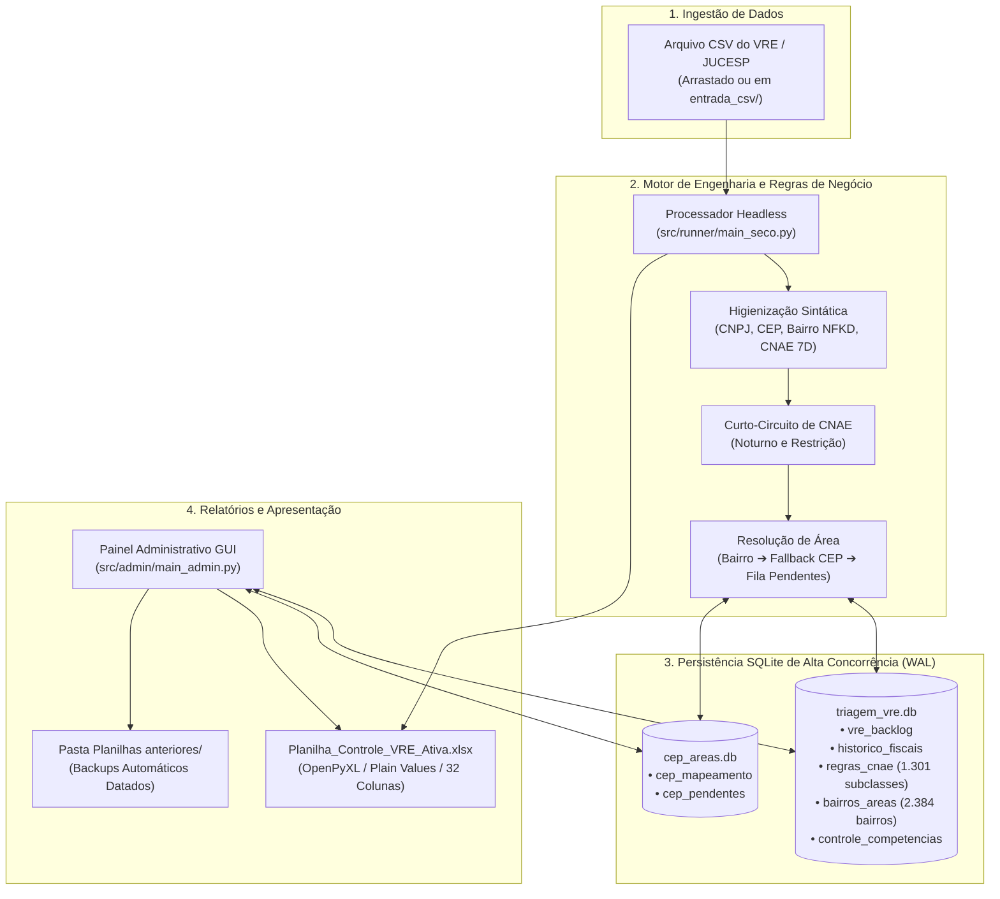

# 🏛️ Automação de Triagem VRE — SMAURB / Inspetoria Fiscal

[](https://github.com/usuario-ou-orgao/automacao-triagem-vre/actions)
[](https://www.python.org/)
[](LICENSE)
[](https://www.sqlite.org/wal.html)
[](https://github.com/psf/black)
[](https://github.com/astral-sh/ruff)

Sistema de automação de engenharia de software de alta performance para processamento, classificação normativa e distribuição de vistorias de posturas do **Via Rápida Empresa (VRE)** na Inspetoria Fiscal da Secretaria Municipal de Habitação e Urbanismo (SMAURB) de São José do Rio Preto/SP.

---

## 🧭 Sumário Executivo

O sistema substitui o fluxo manual e fragmentado de distribuição de vistorias empresariais, eliminando lentidão no Excel e quedas de rede ao aplicar:
1. **Executável Operacional Seco (`triagem_vre` / `src/runner/main_seco.py`)**:
   - Padrão *Single-Action Headless Runner* (duplo clique ou arraste de arquivos `.csv`).
   - Identificação do fiscal anterior via histórico indexado em B-Tree no SQLite em $O(\log N)$.
   - Algoritmo de curto-circuito (*Short-Circuit*) no matching de CNAEs (Restrição e Noturno).
   - Resolução de Área fiscal via Bairro normalizado (Unicode NFKD) com fallback para banco dinâmico de CEPs (`cep_areas.db`).
   - Proteção de edições prévias de operadores e fiscais no backlog (`INSERT OR IGNORE`).
   - Injeção exclusiva de **Plain Values** (valores estáticos literais) na `Planilha_Controle_VRE_Ativa.xlsx`, eliminando 100% dos travamentos de fórmulas no Excel.
2. **Executável Administrativo GUI (`config_vre` / `src/admin/main_admin.py`)**:
   - Interface Tkinter nativa com três módulos operacionais:
     - **Aba 1 — Busca de Histórico**: Pesquisa instantânea por CNPJ ou Razão Social.
     - **Aba 2 — Gestão de CEP x Área**: Cadastro de logradouros novos e resolução da fila de CEPs pendentes com *backfill* automático no backlog.
     - **Aba 3 — Arquivamento de Competências**: Controle de visibilidade mensal (Ativo/Arquivado), geração de cópias de segurança em `Planilhas anteriores/` e preservação perene no SQLite.

---

## 🏗️ Arquitetura do Sistema



---

## 📁 Estrutura do Repositório

```text
├── .github/
│   ├── workflows/ci.yml         # Pipeline de CI (Python 3.10, 3.11, 3.12)
│   ├── ISSUE_TEMPLATE/          # Templates de Bug Report e Feature Request
│   └── PULL_REQUEST_TEMPLATE.md # Template para submissão de código
├── docs/                        # Documentação clássica de Engenharia de Software (UML 2.5 e Mermaid)
│   ├── 00_INDICE.md             # Mapa e guia de navegação
│   ├── 01-visao-geral-e-arquitetura.md # Arquitetura Limpa, Modelo 4+1, Stack e Componentes
│   ├── 02-requisitos.md                # Requisitos Funcionais (RF01-26) e Não-Funcionais (RNF01-10)
│   ├── 03-casos-de-uso.md              # Diagrama Mermaid e Especificações Formais (UC01-UC07)
│   ├── 04-fluxos-e-modelagem.md        # Sequência, Classes, DER Relacional e Máquinas de Estados
│   └── 05-guia-tecnico-e-manutencao.md # Runbook, Troubleshooting, Testes e ADRs (ADR-001 a 008)
├── src/                         # Código-fonte modular da aplicação
│   ├── core/                    # Configuração, SQLite, Normalização, CEP e Excel Writer
│   ├── runner/                  # Executável seco e importador de histórico
│   └── admin/                   # Interface gráfica Tkinter e serviço de arquivamento
├── database/                    # Schemas DDL, seeding e dados de referência
│   ├── schema.sql               # DDL do banco central triagem_vre.db
│   ├── schema_cep.sql           # DDL do banco satélite cep_areas.db
│   ├── init_db.py               # Inicializador do ecossistema de bancos
│   ├── seed_bairros.py          # Seeder de bairros e áreas fiscais
│   ├── seed_cnaes.py            # Seeder com algoritmo de herança hierárquica
│   ├── seed_historico.py        # Seeder de histórico e CEPs com fallback sintético
│   └── dados_referencia/        # Planilhas públicas normativas e fixtures
├── templates/                   # Template base XLSX e imagens institucionais
├── tests/                       # Testes automatizados (Unitários e Integração End-to-End)
│   ├── test_data/               # Fixtures sintéticas de teste (100% LGPD compliant)
│   ├── executar_bateria_testes.py # Runner de validação de todos os cenários
│   └── test_*.py                # Suítes de teste de unidade
├── scripts/                     # Lançadores em lote (.bat), script invisível (.vbs) e build
├── .env.example                 # Exemplo de configuração de variáveis de ambiente
├── .gitignore                   # Regras abrangentes de exclusão do Git
├── CHANGELOG.md                 # Histórico formal de lançamentos
├── CONTRIBUTING.md              # Diretrizes de contribuição e padrões de código
├── LICENSE                      # Licença MIT
└── pyproject.toml               # Configuração moderna de empacotamento PEP 517/621
```

---

## 🚀 Instalação e Execução

### Pré-requisitos
- Python 3.10 ou superior
- Pip e Virtualenv instalados

### 1. Clonar e Instalar Dependências
```bash
git clone https://github.com/usuario-ou-orgao/automacao-triagem-vre.git
cd automacao-triagem-vre

# Criar e ativar ambiente virtual
python -m venv .venv
source .venv/bin/activate  # No Windows: .venv\Scripts\Activate.ps1

# Instalar dependências
pip install -r requirements.txt
```

### 2. Inicializar e Popular os Bancos SQLite
```bash
python database/init_db.py --seed
```
*O comando inicializa `triagem_vre.db` e `cep_areas.db`, herda as regras das 1.301 subclasses de CNAE, normaliza os 2.384 bairros e carrega o conjunto demonstrativo de histórico.*

### 3. Execução Operacional (Modo Seco)
```bash
# Processa o CSV mais recente presente em entrada_csv/ ou na raiz:
python src/runner/main_seco.py

# Ou informando um arquivo específico:
python src/runner/main_seco.py "caminho/para/remessa.csv" --verbose
```

### 4. Execução do Painel Administrativo
```bash
# Interface Gráfica (Tkinter):
python src/admin/main_admin.py

# Modo Linha de Comando (para servidores sem interface de vídeo):
python src/admin/main_admin.py --cli
```

---

## 🧪 Suíte de Testes Automatizados

O repositório inclui cobertura completa de testes unitários, testes de limites (*edge cases*) e bateria de integração de ponta a ponta com dados sintéticos:

```bash
# 1. Execução de todos os testes unitários (36 testes):
python -m unittest discover -s tests -p "test_*.py" -v

# 2. Execução da bateria completa de 8 cenários end-to-end:
python tests/executar_bateria_testes.py

# 3. Execução com pytest (se instalado):
pytest -v
```

---

## 🔨 Compilação de Executáveis para Windows (`.exe`)

Para gerar os binários autônomos (`triagem_vre.exe` e `config_vre.exe`) empacotados na pasta `fbuild/`:

```cmd
build_all.bat
```
Ou em ambientes Linux/macOS:
```bash
./build_all.sh
```

---

## 🛡️ Mitigação de Antivírus Corporativo (Symantec / Windows Defender)

Antivírus corporativos com análise heurística (como o Symantec Endpoint Protection) podem sinalizar temporariamente executáveis recém-compilados pelo PyInstaller (`WS.Reputation.1`).

O projeto oferece **três soluções imediatas**:
1. **Lançadores Nativos Portáteis (Recomendado)**: Utilizam o interpretador oficial `python.exe` / `pythonw.exe` assinado digitalmente pela *Python Software Foundation*, 100% aceito pelo antivírus corporativo:
   - `Executar_Triagem.bat`: Interface rápida interativa (aceita arrastar CSVs por cima).
   - `Executar_Triagem_Silencioso.vbs`: Execução invisível em segundo plano sem janela de console.
   - `Painel_Administrativo.bat`: Abertura direta do painel de controle.
2. **Assinatura Digital Authenticode**: O script `scripts/assinar_executaveis.ps1` cria um certificado de assinatura de código local e assina digitalmente os binários compilados.

---

## 🔒 Conformidade com a LGPD e Segurança

Este repositório foi rigorosamente auditado e sanitizado:
- Não contém dados pessoais, bancários, CPFs ou históricos reais de contribuintes e servidores.
- Todos os testes utilizam exclusivamente dados sintéticos e fictícios.
- Consulte a nossa [Política de Segurança e LGPD](SECURITY.md) para mais informações.

---

## 📄 Licença

Distribuído sob a licença **MIT**. Consulte o arquivo [LICENSE](LICENSE) para obter detalhes completos.
