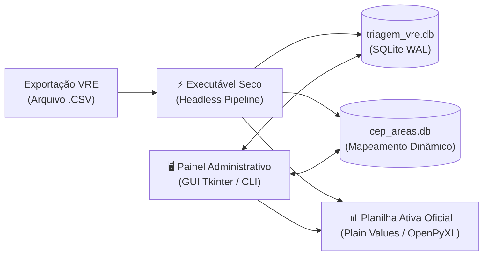

# Portal de Documentação de Engenharia de Software — Triagem VRE

Bem-vindo à documentação técnica oficial do **Sistema de Automação de Triagem VRE** da Inspetoria Fiscal (SMAURB / Município de São José do Rio Preto).

Esta documentação foi elaborada segundo os padrões clássicos e formais da Engenharia de Software (IEEE 830, ISO/IEC/IEEE 29148, Modelo 4+1 de Kruchten e Notação UML 2.5 da OMG com diagramas interativos Mermaid.js).

---

## 🧭 Mapa da Documentação Técnica (v2.2.0 / Patch v1.6)

| Código | Documento | Padrão / Escopo |
| :--- | :--- | :--- |
| **[DOC-01](01-visao-geral-e-arquitetura.md)** | **Visão Geral e Arquitetura do Sistema** | Escopo, Stack Tecnológica, Visão de Componentes, Árvore de Diretórios e Princípios de Arquitetura Limpa. |
| **[DOC-02](02-requisitos.md)** | **Especificação de Requisitos de Software (SRS)** | IEEE 830: 26 Requisitos Funcionais (RF01 a RF26), 10 Não-Funcionais (RNF01 a RNF10) e Regras de Negócio Normativas. |
| **[DOC-03](03-casos-de-uso.md)** | **Modelo de Casos de Uso (UML / Mermaid)** | Diagrama de Casos de Uso e especificações textuais formais completas (UC01 a UC07) cobrindo todos os fluxos de atores. |
| **[DOC-04](04-fluxos-e-modelagem.md)** | **Fluxos Operacionais e Modelagem de Dados** | Diagramas de Sequência (Ingestão, Sync Bidirecional, Arquivamento, Importação Antigas), Diagrama de Classes, DER e Máquinas de Estados. |
| **[DOC-05](05-guia-tecnico-e-manutencao.md)** | **Guia Técnico, Manutenção e Registros de Decisão (ADRs)** | Configuração de Ambientes, Guia de Execução, Suíte de Testes, Troubleshooting, Política de Patches e ADR-001 a ADR-008. |

---

## 🏛️ Visão Executiva do Sistema

O sistema resolve o gargalo operacional crítico da administração municipal: a distribuição diária de vistorias de posturas e licenciamento empresarial de centenas de novas empresas emitidas pela Junta Comercial do Estado de São Paulo (JUCESP) via plataforma Via Rápida Empresa (VRE).

