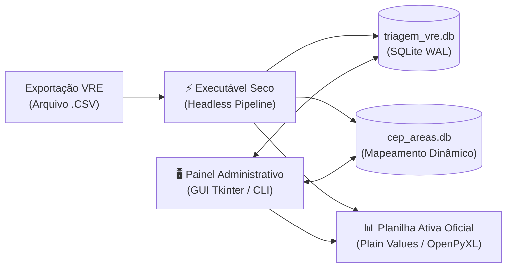

# Portal de Documentação de Engenharia de Software — Triagem VRE

Bem-vindo à documentação técnica oficial do **Sistema de Automação de Triagem VRE** da Inspetoria Fiscal (SMAURB / Município de São José do Rio Preto).

Esta documentação foi elaborada segundo os padrões clássicos e formais da Engenharia de Software (IEEE 830, ISO/IEC/IEEE 29148, Modelo 4+1 de Kruchten e Notação UML 2.5 da OMG).

---

## 🧭 Mapa da Documentação Técnica

| Código | Documento | Padrão / Escopo |
| :--- | :--- | :--- |
| **[DOC-01](01_ESPECIFICACAO_REQUISITOS_SRS.md)** | **Especificação de Requisitos de Software (SRS)** | IEEE 830 / ISO 29148: Escopo, Atores, Requisitos Funcionais, Não-Funcionais e Regras de Negócio |
| **[DOC-02](02_ARQUITETURA_E_VISAO_4PLUS1.md)** | **Documento de Arquitetura de Software (DAS)** | Modelo 4+1 de Philippe Kruchten: Visões Lógica, de Processo, de Desenvolvimento e Física |
| **[DOC-03](03_MODELO_CASOS_DE_USO_UML.md)** | **Modelo de Casos de Uso (UML 2.5)** | Diagrama de Casos de Uso e especificações textuais formais (UC01 a UC06) |
| **[DOC-04](04_DIAGRAMA_CLASSES_DOMINIO_UML.md)** | **Modelo Estrutural e Diagrama de Classes** | Diagrama de Classes completo (Domínio, Repositórios, Serviços e Apresentação) |
| **[DOC-05](05_DIAGRAMAS_SEQUENCIA_E_ATIVIDADE_UML.md)** | **Diagramas de Sequência e Atividades** | Interações temporais, mensagens e fluxos com raias de responsabilidade (swimlanes) |
| **[DOC-06](06_DIAGRAMA_ESTADOS_E_IMPLANTACAO_UML.md)** | **Diagramas de Estados e Implantação** | Ciclo de vida dos protocolos e topologia física de nós, hardware e executáveis |
| **[DOC-07](07_MODELO_DADOS_RELACIONAL_MER.md)** | **Modelo de Dados Relacional (MER / DER)** | Diagrama Entidade-Relacionamento, Dicionário de Dados, 3ª Forma Normal e Índices |
| **[DOC-08](08_REGISTRO_DECISOES_ARQUITETURA_ADR.md)** | **Registros de Decisões de Arquitetura (ADR)** | Histórico de deliberações técnicas fundamentadas (ADR-001 a ADR-005) |
| **[DOC-09](09_MANUAL_OPERACIONAL_E_IMPLANTACAO.md)** | **Manual de Implantação e Operação (Runbook)** | Guia de instalação, compilação, homologação, mitigação de antivírus e LGPD |

---

## 🏛️ Visão Executiva do Sistema

O sistema resolve um dos gargalos operacionais mais críticos da administração municipal: a distribuição diária de vistorias de posturas e licenciamento empresarial de centenas de novas empresas emitidas pela Junta Comercial do Estado de São Paulo (JUCESP) via plataforma Via Rápida Empresa (VRE).

