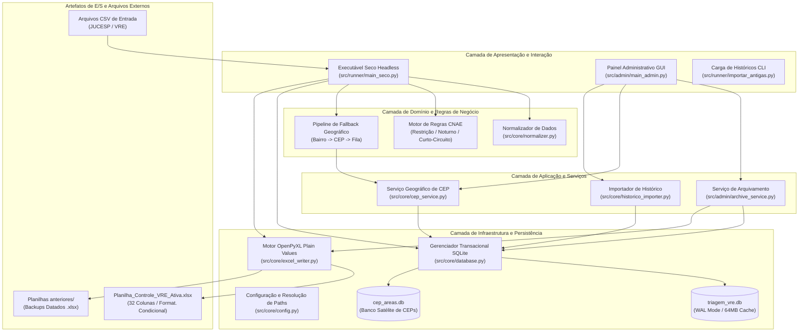

# 01 — Visão Geral e Arquitetura do Sistema

**Sistema**: Automação de Triagem VRE & Gestão Fiscal  
**Órgão**: Prefeitura Municipal de São José do Rio Preto — SP  
**Secretaria**: Secretaria Municipal de Habitação e Urbanismo (SMAURB) / Inspetoria Fiscal  
**Versão**: 2.2.0 (Patch v1.6)  
**Padrão de Engenharia**: Clean Architecture / Ports and Adapters / Layered System  

---

## 1. Escopo e Propósito do Sistema

O **Sistema de Automação de Triagem VRE** foi concebido e implantado para modernizar, acelerar e padronizar o processo de triagem regulatória de pedidos de viabilidade e licenciamento empresarial originados do portal estadual **Via Rápida Empresa (VRE / JUCESP)**.

### 1.1. Contexto Operacional Anterior
Historicamente, os arquivos CSV contendo os pedidos de licenciamento de novas empresas e alterações cadastrais eram manipulados diretamente em planilhas eletrônicas com dezenas de colunas e fórmulas dinâmicas (`PROCV`, `ÍNDICE/CORRESP`, `SE`). Esse formato gerava:
1. **Lentidão e Travamentos Críticos**: Planilhas com mais de 3.000 linhas demoravam minutos para abrir e frequentemente corrompiam ou travavam o Microsoft Excel.
2. **Atribuição Manual Inconsistente**: Falta de memória institucional na vinculação de fiscais titulares anteriores aos CNPJs.
3. **Inconclusão Geográfica**: Inconsistências na identificação da Área Fiscal (Central, HB, Bosque, Represa, Schmitt, etc.) devido a grafias heterogêneas de bairros e CEPs não mapeados.
4. **Vulnerabilidade de Sobrescrita**: Falta de sincronização bidirecional entre alterações manuais dos fiscais e o banco de dados central.

### 1.2. Solução Implementada
O sistema automatiza integralmente o pipeline operacional:
- Ingestão tolerante a falhas de arquivos CSV com múltiplos encodings (UTF-8, Latin-1, CP1252).
- Higienização e sanitização determinística de CNPJs, CEPs, Bairros e CNAEs.
- Motor de regras de zoneamento com **curto-circuito** para classificação de atividades de risco diurno e noturno.
- Pipeline geográfico com **fallback em 3 níveis**: Bairro Normalizado $\rightarrow$ CEP Mapeado $\rightarrow$ Fila de Pendências.
- Geração instantânea da planilha de trabalho ativa (`Planilha_Controle_VRE_Ativa.xlsx`) utilizando **Plain Values** (valores literais pré-computados) e **15 regras de formatação condicional** na exata hierarquia visual exigida pela SMAURB.
- Sincronização bidirecional baseada em **hash SHA-256** para capturar edições humanas do Excel diretamente para o SQLite.
- Módulo de arquivamento por competência mensal e interface administrativa (GUI) nativa em Tkinter.

---

## 2. Stack Tecnológica e Ferramental

| Componente | Tecnologia / Ferramenta | Justificativa Técnica |
| :--- | :--- | :--- |
| **Linguagem Base** | Python 3.12 (CPython x64) | Linguagem de alto nível com tipagem estática moderna (`typing`), rica biblioteca padrão e suporte a binários portáteis. |
| **Manipulação Excel** | `openpyxl` (v3.1.5+) | Biblioteca robusta e livre de dependências COM do Windows, com suporte completo a estilos, larguras de coluna e formatação condicional XML nativa. |
| **Banco de Dados Central** | SQLite 3 (`triagem_vre.db`) | Banco relacional embarcado, zero-configuration, ACID, configurado em modo WAL para concorrência de leitura e escrita. |
| **Banco de Dados Satélite** | SQLite 3 (`cep_areas.db`) | Banco satélite desacoplado para isolar o mapeamento geográfico de CEPs e log de ocorrências pendentes. |
| **Interface Gráfica (GUI)** | Tkinter / `ttk` Nativo | Interface multiplataforma integrada ao interpretador Python, eliminando dependências pesadas de frameworks externos (ex: Qt/Electron). |
| **Empacotamento / Deploy** | PyInstaller + Pacote Portátil | Capacidade de execução via executáveis autocontidos (`.exe`) ou via pacote portátil com interpretador embutido em `Configurações/python/`. |
| **Testes Automatizados** | `unittest` (Standard Library) | Suíte formal com testes unitários, testes de integração, testes de regressão e bateria de carga em lote (500 linhas). |

---

## 3. Estrutura de Diretórios do Projeto

```
PROJETO VRE/
├── Configurações/                     # Núcleo da versão portátil Windows
│   ├── database/                      # Bancos SQLite e schemas DDL
│   │   ├── schema.sql                 # DDL do banco central
│   │   ├── schema_cep.sql             # DDL do banco satélite
│   │   ├── triagem_vre.db             # Banco central operacional
│   │   └── cep_areas.db               # Banco satélite de CEPs
│   ├── entrada_csv/                   # Pasta para recepção de CSVs do VRE
│   │   └── processados/               # Arquivamento com carimbo de tempo
│   ├── python/                        # Interpretador Python 3.12 embutido
│   ├── templates/                     # Templates de planilha e brasão oficial
│   │   ├── template_triagem.xlsx      # Template protótipo de 32 colunas
│   │   └── logo_rio_preto.png         # Brasão de São José do Rio Preto
│   └── src/                           # Código-fonte da aplicação portátil
├── docs/                              # Documentação formal de engenharia
│   ├── 01-visao-geral-e-arquitetura.md# Visão geral, escopo e arquitetura
│   ├── 02-requisitos.md               # Requisitos funcionais e não funcionais
│   ├── 03-casos-de-uso.md             # Modelagem de casos de uso e atores
│   ├── 04-fluxos-e-modelagem.md       # Diagramas de sequência, classes e estados
│   └── 05-guia-tecnico-e-manutencao.md# Guia de implantação, ADRs e manutenção
├── Patchs de atualização/             # Pacotes incrementais de update (Patch v1.X.zip)
├── Planilhas anteriores/              # Backups preventivos datados gerados pelo sistema
├── src/                               # Código-fonte principal do projeto
│   ├── admin/                         # Camada de backoffice e interface gráfica
│   │   ├── __init__.py                # Exportações e interfaces públicas
│   │   ├── archive_service.py         # Regras de negócio de arquivamento e busca
│   │   └── main_admin.py              # Executável GUI Tkinter (config_vre.exe)
│   ├── core/                          # Camada de domínio, infraestrutura e persistência
│   │   ├── __init__.py                # Exportações e utilitários fundamentais
│   │   ├── config.py                  # Configuração centralizada e resolução de paths
│   │   ├── database.py                # Gerenciador transacional e conexões SQLite
│   │   ├── normalizer.py              # Sanitização matemática de CNPJ, CEP, CNAE, Bairro
│   │   ├── cep_service.py             # Mapeamento geográfico e fila de pendências
│   │   ├── historico_importer.py      # Processador de deduplicação e carga histórica
│   │   └── excel_writer.py            # Motor de escrita OpenPyXL e formatação condicional
│   └── runner/                        # Camada de execução em lote e CLI
│       ├── __init__.py                # Exportações do subpacote runner
│       ├── main_seco.py               # Executável seco headless (triagem_vre.exe)
│       └── importar_antigas.py        # Utilitário CLI para carga em lote de histórico
├── templates/                         # Templates de desenvolvimento
├── tests/                             # Suíte formal de testes automatizados
│   ├── test_excel_writer.py           # Testes de geração e fidelidade visual do Excel
│   ├── test_admin_gui.py              # Testes do painel administrativo
│   ├── test_normalizer.py             # Testes de sanitização de strings
│   ├── test_historico_importer.py     # Testes de deduplicação e carga legada
│   ├── test_integration.py            # Testes de integração ponta a ponta
│   ├── test_archive.py                # Testes de arquivamento de competências
│   ├── test_edge_cases.py             # Testes de casos limite e dados corrompidos
│   ├── test_cep_service.py            # Testes do pipeline geográfico de CEP
│   ├── test_cnae_seed.py              # Testes de carga de regras CNAE
│   └── executar_bateria_testes.py     # Runner consolidado da bateria de homologação
├── Executar_Triagem.bat               # Atalho para execução com console
├── Executar_Triagem_Silencioso.vbs    # Atalho para execução 100% silenciosa em background
├── Painel_Administrativo.bat          # Atalho para abertura da GUI
├── Importar_Planilhas_Antigas.bat     # Atalho para carga de históricos
├── Planilha_Controle_VRE_Ativa.xlsx   # Planilha de trabalho oficial gerada em produção
└── GEMINI.md                          # Diretrizes operacionais e padrão obrigatório de patches
```

---

## 4. Arquitetura de Componentes e Fluxo de Dados

O sistema adota uma arquitetura em camadas concêntricas (*Clean Architecture / Hexagonal*), garantindo que regras de negócio fundamentais não dependam de bibliotecas visuais ou formatos específicos de persistência:



---

## 5. Princípios de Engenharia e Padrões Adotados

### 5.1. Regra de Ouro: Zero Regressão
Toda evolução arquitetural ou adição de código preserva 100% dos contratos preexistentes de funções, interfaces de linha de comando, schemas de banco de dados e assinaturas públicas. A integridade funcional é comprovada pela aprovação sem ressalvas da suíte de 37 testes unitários e bateria formal de homologação.

### 5.2. Padrão Plain Values no Microsoft Excel
Para evitar travamentos e bloqueios de segurança do Microsoft Office em máquinas com recursos limitados de hardware:
- Nenhuma fórmula dinâmica (como `=PROCV(...)` ou `=SE(...)`) é escrita nas linhas de dados.
- Todos os cruzamentos relacionais são resolvidos em memória e em SQLite no Python, e gravados como texto/número puro estático.
- A formatação condicional é declarada em um único intervalo contínuo (`A3:AF5000`), evitando fragmentação de regras no arquivo `.xlsx`.

### 5.3. Sincronização Bidirecional com Rastreamento por Hash SHA-256
O sistema respeita a autonomia de trabalho dos fiscais. Sempre que a rotina de triagem ou arquivamento é executada:
1. O hash SHA-256 da planilha em disco é comparado com o hash gravado na última geração.
2. Se o hash divergir, significa que o operador editou o arquivo manualmente no Excel.
3. Todas as alterações em **Status**, **Fiscal**, **Tipo de Serviço**, **Restrição**, **Data**, **IPTU**, **Área**, **Protocolo Sigm / OS** e **Endereço** são lidas e persistidas no SQLite antes de qualquer nova escrita.
4. O aprendizado é retroalimentado: fiscais atribuídos e CEPs vinculados passam a integrar o histórico permanente.
