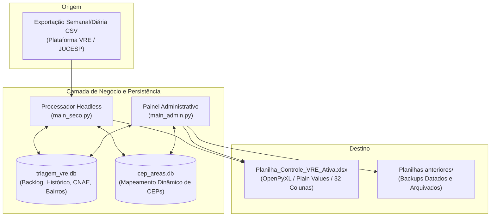

# Especificação de Requisitos de Software (SRS)

**Padrão**: IEEE 830 / ISO/IEC/IEEE 29148  
**Sistema**: Automação de Triagem VRE — SMAURB / Inspetoria Fiscal  
**Versão**: 2.2.0  
**Data**: Outubro/2026  

---

## 1. Introdução

### 1.1. Finalidade do Documento
Este documento formaliza a Especificação de Requisitos de Software (SRS) do sistema de triagem automatizada de protocolos de licenciamento empresarial do **Via Rápida Empresa (VRE)** no âmbito da Inspetoria Fiscal da Secretaria Municipal de Habitação e Urbanismo (SMAURB). O documento serve de base contratual de engenharia para desenvolvimento, validação, homologação e manutenção do sistema.

### 1.2. Escopo do Produto
O software destina-se a automatizar a ingestão diária de relatórios CSV exportados pela JUCESP/VRE, cruzar dados cadastrais com bases normativas e históricas municipais em SQLite, aplicar regras de zoneamento fiscal e gerar instantaneamente a planilha operacional de trabalho utilizada pelos auditores e operadores de triagem, eliminando travamentos de fórmulas no Microsoft Excel e erros de atribuição manual.

### 1.3. Definições, Acrônimos e Abreviações
- **VRE**: Via Rápida Empresa (programa integrador estadual JUCESP).
- **SIL**: Sistema Integrado de Licenciamento.
- **CNAE**: Classificação Nacional de Atividades Econômicas (IBGE).
- **SMAURB**: Secretaria Municipal de Habitação e Urbanismo de São José do Rio Preto/SP.
- **WAL**: *Write-Ahead Logging* (modo de alta concorrência do SQLite).
- **Plain Values**: Valores literais estáticos (texto puro), livres de fórmulas computadas em tempo real como `PROCV` ou `ÍNDICE/CORRESP`.
- **NFKD**: *Normal Form Compatibility Decomposition* (algoritmo Unicode de normalização).
- **LGPD**: Lei Geral de Proteção de Dados Pessoais (Lei Federal nº 13.709/2018).

---

## 2. Descrição Geral

### 2.1. Perspectiva do Produto
O sistema atua como intermediário inteligente entre as exportações tabulares do governo estadual (VRE) e as ferramentas do usuário final (Microsoft Excel institucional). A arquitetura é composta por dois executáveis autônomos:
1. **Módulo Operacional Headless (`triagem_vre`)**: Processador rápido de lote via duplo clique ou arraste (Drag & Drop).
2. **Módulo Administrativo GUI (`config_vre`)**: Painel de controle visual em Tkinter nativo para consulta de histórico, resolução de logradouros/CEPs e gestão de arquivamento.

### 2.2. Atores e Perfis de Usuário
- **Operador de Triagem**: Responsável por receber o CSV semanal/diário, processar a triagem e despachar as vistorias aos fiscais. Demanda simplicidade de uso (duplo clique ou arraste).
- **Inspetor / Auditor Fiscal**: Profissional de campo que recebe as vistorias atribuídas segundo o histórico e zoneamento de sua respectiva Área (HB, Central, Bosque, etc.).
- **Administrador do Sistema / Gestor**: Responsável por cadastrar novos CEPs desconhecidos, pesquisar históricos de atendimento e arquivar competências de meses anteriores.

---

## 3. Requisitos Específicos

### 3.1. Requisitos Funcionais (RF)

| ID | Título | Descrição | Prioridade |
| :--- | :--- | :--- | :--- |
| **RF01** | Ingestão Flexível de CSV | O sistema deve aceitar arquivos `.csv` via argumento de linha de comando (`sys.argv[1]`), arraste de arquivo sobre o executável/atalho, ou varredura automática do arquivo mais recente na pasta `entrada_csv/`. | Essencial |
| **RF02** | Autodetecção de Encoding | O motor de leitura deve testar transparentemente os encodings `utf-8-sig`, `utf-8`, `cp1252`, `iso-8859-1` e `latin-1`, com delimitador padrão `;`. | Essencial |
| **RF03** | Sanitização de CNPJ | O sistema deve higienizar o CNPJ removendo pontuações, tratando representações float do Excel e aplicando preenchimento com zeros à esquerda (`zfill(14)`). | Essencial |
| **RF04** | Atribuição por Histórico Fiscal | O sistema deve consultar o banco SQLite e atribuir o fiscal anterior registrado para o mesmo CNPJ limpo em complexidade $O(\log N)$, preservando a continuidade fiscal. | Essencial |
| **RF05** | Fatiamento de CNAE | O sistema deve extrair códigos de CNAE (mesmo que informados com 9 dígitos ou múltiplos por vírgula) e fatiar para 7 dígitos canônicos sem pontuação. | Essencial |
| **RF06** | Curto-Circuito de Matching de CNAE | Ao analisar as atividades da empresa, o algoritmo deve consultar a tabela `regras_cnae`. Se ambas as flags (`restricao = 1` e `noturno = 1`) forem atingidas, o loop de CNAEs deve ser interrompido imediatamente. | Alta |
| **RF07** | Classificação Consolidada de Restrição | O sistema deve preencher a coluna única de 'Restrição' com base nas flags: `Noturno` (se noturno=1), `Com Restrição` (se restricao=1 e noturno=0) e `Sem Restrição` (demais casos). | Essencial |
| **RF08** | Resolução de Área por Bairro Normalizado | O sistema deve aplicar decomposição Unicode NFKD, remoção de acentos e expansão de abreviações consagradas (`JD` $\rightarrow$ `JARDIM`, `PQ` $\rightarrow$ `PARQUE`), casando com a tabela `bairros_areas`. | Essencial |
| **RF09** | Fallback Dinâmico para CEP | Caso o bairro não conste na base oficial ou seja inconclusivo, o sistema deve consultar automaticamente o banco `cep_areas.db`. | Essencial |
| **RF10** | Fila de CEPs Pendentes | Se nem bairro nem CEP resolverem a Área municipal, o CEP de 8 dígitos deve ser enfileirado na tabela `cep_pendentes` com contagem incremental de ocorrências. | Alta |
| **RF11** | Proteção de Backlog (`INSERT OR IGNORE`) | Protocolos já importados previamente não devem ter seu fiscal atribuído, status ou tipo de serviço sobrescritos por novas execuções da triagem. | Essencial |
| **RF12** | Geração Atômica Excel com Plain Values | O sistema deve gerar a `Planilha_Controle_VRE_Ativa.xlsx` injetando exclusivamente valores estáticos de texto/número puro, gravando primeiro em arquivo temporário e aplicando `rename` atômico. | Essencial |
| **RF13** | Formatação Condicional Institucional | A planilha de saída deve reproduzir fielmente a paleta de cores padrão SMAURB através das 15 regras de formatação condicional aplicadas via OpenPyXL. | Alta |
| **RF14** | Painel Administrativo Gráfico (GUI) | O módulo administrativo deve disponibilizar interface gráfica nativa em Tkinter com abas para: (1) Busca de Histórico, (2) Gestão de CEPs e (3) Arquivamento de Competências. | Média |
| **RF15** | Arquivamento e Visibilidade de Competências | O sistema deve permitir alternar a visibilidade de meses de competência ('Ativo' ou 'Arquivado'). Ao aplicar, gera backup datado em `Planilhas anteriores/` e reconstrói a planilha ativa apenas com os meses ativos. | Alta |
| **RF16** | Deduplicação e Migração de Planilhas Legadas | O sistema deve disponibilizar rotina de higienização capaz de processar planilhas legadas desorganizadas, descartando duplicatas e normalizando datas com formatos heterogêneos. | Média |

---

### 3.2. Requisitos Não-Funcionais (RNF)

- **RNF01 — Desempenho e Latência**: O processamento de um lote típico de 500 a 1.000 protocolos deve ser concluído em tempo inferior a 2,5 segundos em máquina padrão de escritório.
- **RNF02 — Confiabilidade Transacional**: Todas as operações de escrita no SQLite devem ser encapsuladas em transações atômicas `BEGIN IMMEDIATE ... COMMIT/ROLLBACK`, prevenindo corrupção de dados em caso de queda de energia.
- **RNF03 — Estabilidade do Microsoft Excel**: A planilha de trabalho não deve conter fórmulas voláteis ou encadeadas, eliminando 100% dos travamentos de tela ou avisos de cálculo circular.
- **RNF04 — Resiliência a Falsos Positivos de Antivírus**: O ecossistema deve prover alternativa de execução baseada no interpretador Python oficial assinado digitalmente pela Python Software Foundation (PSF), contornando bloqueios de antivírus corporativos (Symantec/Defender).
- **RNF05 — Portabilidade Multiplataforma**: A lógica de negócio e os testes devem ser agnósticos a sistema operacional, funcionando perfeitamente em Linux, macOS e Windows.
- **RNF06 — Conformidade com a LGPD**: O código-fonte, suítes de teste e documentação de repositório público não devem conter informações reais protegidas de cidadãos ou servidores.
- **RNF07 — Manutenibilidade e Baixo Acoplamento**: A arquitetura deve isolar responsabilidades em camadas distintas (`core`, `runner`, `admin`, `database`), com 100% de cobertura de testes em casos de borda.

---

### 3.3. Regras de Negócio (RN)

- **RN01 — Prevalência de Atribuição Histórica**: Havendo registro prévio em `historico_fiscais` para o CNPJ limpo, o sistema deve atribuir automaticamente o fiscal do atendimento mais recente.
- **RN02 — Herança Hierárquica de CNAE**: As restrições e marcações de horário noturno definidas no nível de Divisão, Grupo ou Classe da CNAE propagam-se obrigatoriamente para todas as suas Subclasses derivadas.
- **RN03 — Prevalência Noturna em Tipo de Serviço**: Na coluna `Tipo de Serviço`, caso a empresa possua concomitantemente restrição de zoneamento e atividade noturna, a classificação `Noturno Livre` tem precedência hierárquica visual.
- **RN04 — Proteção de Dados Editados**: Campos editados manualmente na planilha ativa ou alterados no backlog nunca podem ser apagados ou substituídos por um reprocessamento de CSV.
- **RN05 — Omissão de Status Transitórios**: Os status `PENDENTE` e `DISTRIBUIDO` não devem ter seus nomes impressos na coluna B ("Status") da planilha de trabalho ativa, permanecendo vazios para preenchimento posterior pelo fiscal.
- **RN06 — Prevalência da Data Oficial do VRE**: Na determinação do mês de competência, a data oficial de expedição da licença no VRE (Coluna `Data` do VRE) prevalece sobre a data de importação ou distribuição.
