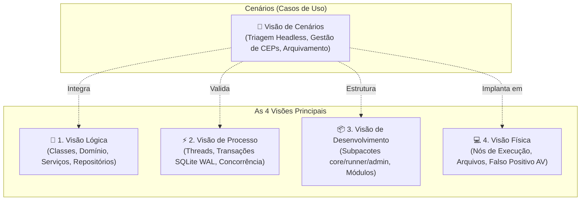
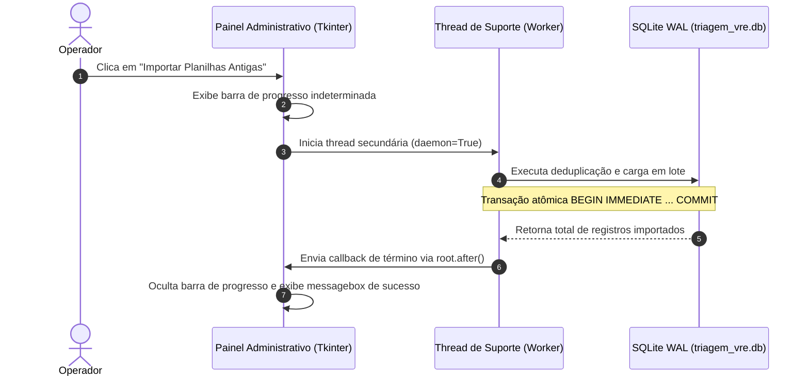
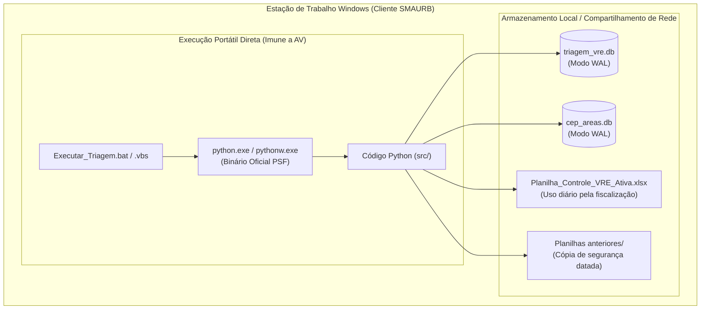

# Documento de Arquitetura de Software (DAS) — Modelo 4+1 de Kruchten

**Sistema**: Automação de Triagem VRE — SMAURB / Inspetoria Fiscal  
**Padrão**: IEEE 42010 / Modelo 4+1 Architectural Views (Philippe Kruchten)  
**Versão**: 2.2.0  

---

## 1. Visão Geral do Modelo 4+1

O Modelo de Visões Arquiteturais "4+1" organiza a descrição do software sob múltiplos pontos de vista para atender diferentes públicos técnicos e partes interessadas:



---

## 2. Visão Lógica (Logical View)

A Visão Lógica descreve a organização funcional do sistema e seus subsistemas orientados a objetos.

### 2.1. Arquitetura em Camadas
O sistema adota uma arquitetura em camadas desacopladas:
1. **Camada de Apresentação (Presentation Layer)**:
   - `main_seco.py`: Padrão *Single-Action Headless Runner* acionado por linha de comando ou arraste de arquivo.
   - `main_admin.py`: Interface Gráfica Orientada a Eventos em Tkinter com abas dedicadas e renderização em Thread assíncrona.
2. **Camada de Aplicação / Serviços (Service Layer)**:
   - `archive_service.py`: Regras de negócio de competência mensal, cálculo de métricas e orquestração de backup.
   - `cep_service.py`: Serviço de geolocalização tributária e resolução em cascata (Bairro $\rightarrow$ CEP $\rightarrow$ Fila de Pendências).
   - `historico_importer.py`: Higienização, deduplicação em memória e migração de planilhas despadronizadas.
3. **Camada de Domínio e Normalização (Domain & Utility Layer)**:
   - `normalizer.py`: Algoritmos puros de higienização sintática de CNPJs, CEPs, Bairros (NFKD) e fatiamento de CNAEs.
4. **Camada de Infraestrutura e Persistência (Data Access Layer)**:
   - `database.py`: Gerenciamento de conexões thread-safe com SQLite, injeção de pragmas de alto desempenho e context managers de transações atômicas.
   - `excel_writer.py`: Motor de gravação atômica com OpenPyXL focado em injeção de *Plain Values* e estilos institucionais.

---

## 3. Visão de Processo (Process View)

A Visão de Processo aborda a dinâmica de tempo de execução, concorrência, transações e ciclo de vida.

### 3.1. Concorrência e Modos de Operação
- **Mapeamento WAL (Write-Ahead Logging)**:
  O banco de dados SQLite é configurado com `PRAGMA journal_mode = WAL;`. Leituras e gravações ocorrem sem bloqueios mútuos, permitindo que a interface administrativa consulte dados enquanto o processador headless ingere novos registros.
- **Multithreading na Interface Gráfica**:
  No painel administrativo (`main_admin.py`), operações longas de I/O (leitura de planilhas de 5.000 linhas) são despachadas para threads de suporte (`threading.Thread`), mantendo o loop de eventos do Tkinter (`root.mainloop()`) responsivo a 60 FPS.



---

## 4. Visão de Desenvolvimento (Development View)

A Visão de Desenvolvimento descreve a organização modular do código-fonte no sistema de arquivos.

```
projeto_vre_github/
├── src/
│   ├── core/         # Serviços transversais, persistência, Excel e normalização
│   ├── runner/       # Ponto de entrada headless de execução rápida
│   └── admin/        # Interface gráfica e regras de gestão de arquivamento
├── database/         # Schemas SQL (DDL), scripts de carga (seeding) e dados de referência
├── templates/        # Template mestre XLSX oficial e ativos gráficos (brasão)
├── tests/            # Testes unitários, de borda, integração e fixtures sintéticas
└── scripts/          # Lançadores nativos Windows (.bat, .vbs) e scripts de build
```

### 4.1. Princípios de Engenharia Adotados
- **Responsabilidade Única (SRP)**: Cada módulo cuida de uma única preocupação (ex.: `normalizer.py` apenas sanitiza strings, sem dependência de banco de dados).
- **Inversão de Dependências (DIP)**: As funções recebem conexões ou caminhos como parâmetros opcionais, permitindo injeção de dependências em testes de unidade.

---

## 5. Visão Física / Implantação (Physical View)

A Visão Física ilustra a distribuição dos artefatos em nós de hardware e ambiente operacional.



---

## 6. Visão de Cenários (Scenarios / Use Cases)

A quinta visão sintetiza os cenários operacionais críticos que orientam a arquitetura:
1. **Cenário 1 — Ingestão Headless Diária**: O operador arrasta o CSV para o script; o pipeline higieniza dados, atribui fiscais por histórico em milissegundos e atualiza a planilha de trabalho ativa.
2. **Cenário 2 — Resolução de CEP Desconhecido**: O sistema detecta logradouro sem área mapeada, armazena no backlog, enfileira o CEP em `cep_pendentes` e permite que o auditor vincule a área com 2 cliques no painel.
3. **Cenário 3 — Fechamento Mensal de Competência**: A administração arquiva os meses passados; o sistema preserva os protocolos no SQLite, salva backup completo da versão anterior e gera uma planilha limpa apenas com os lotes ativos.
