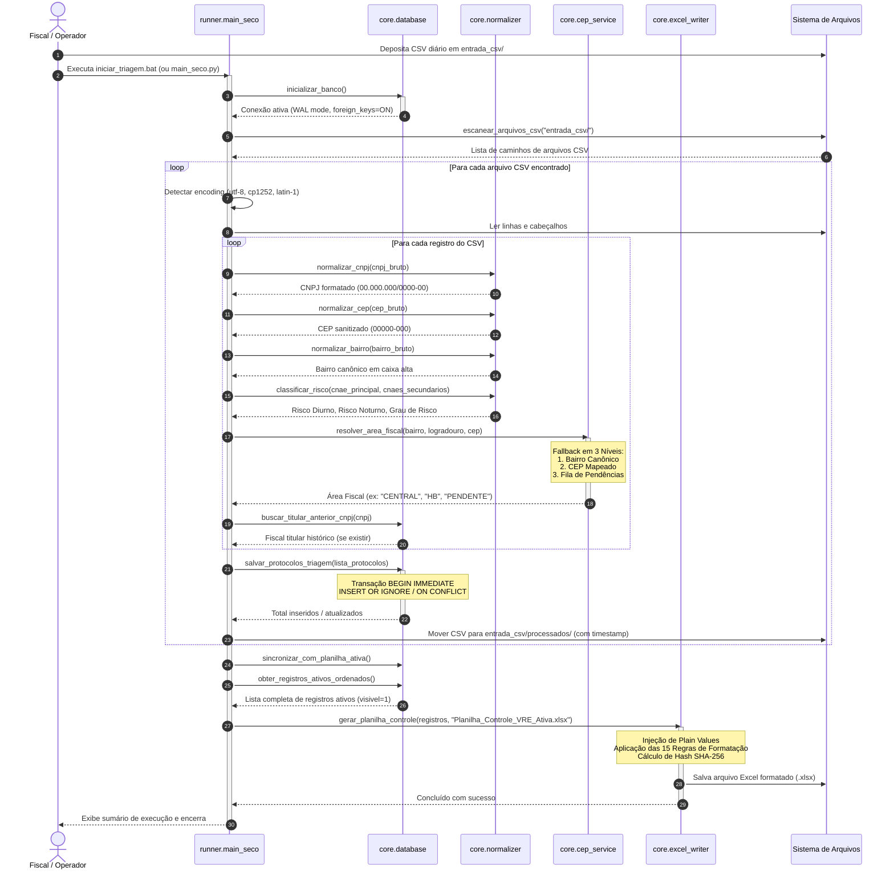
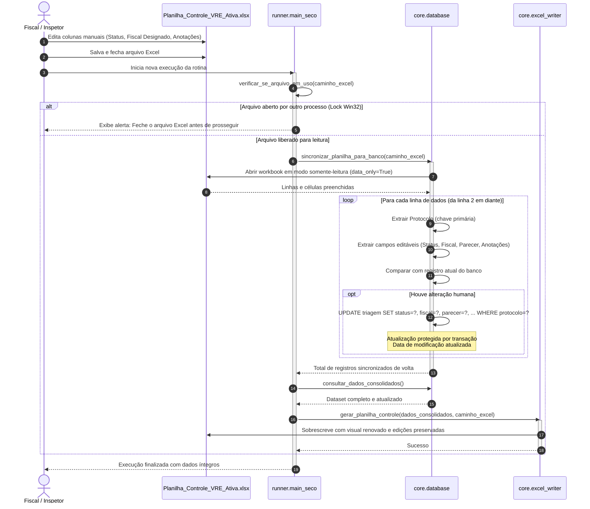
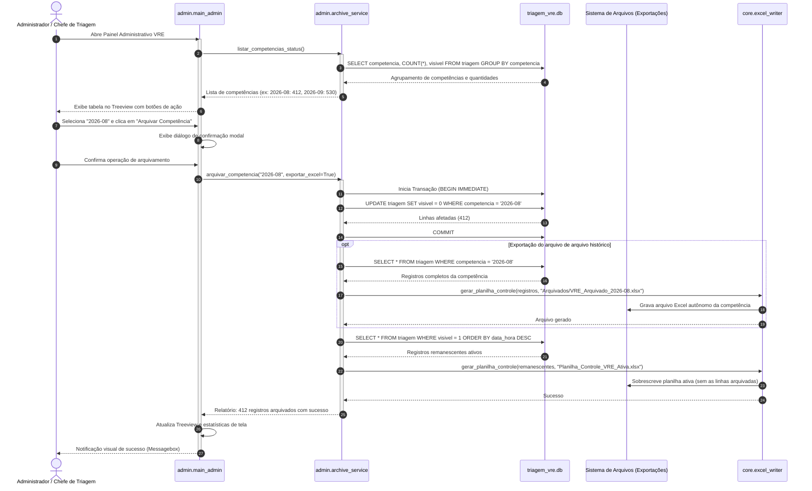
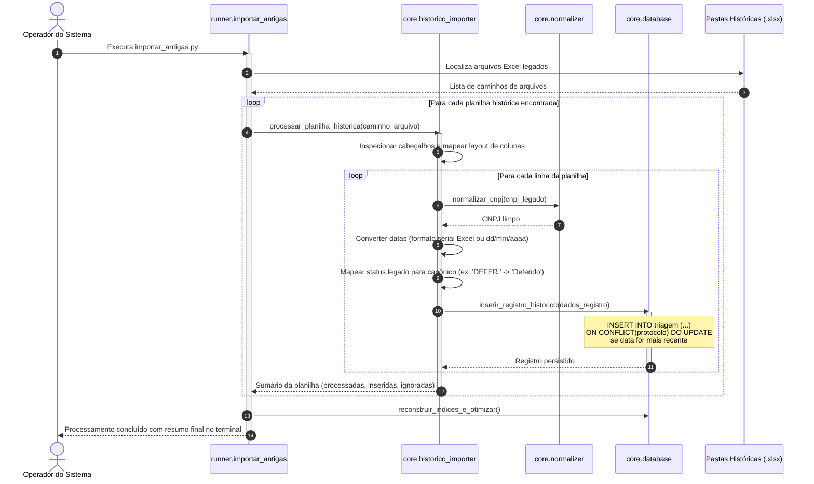
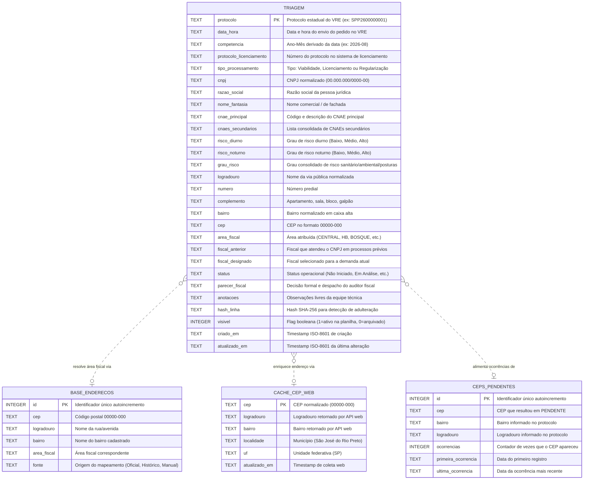
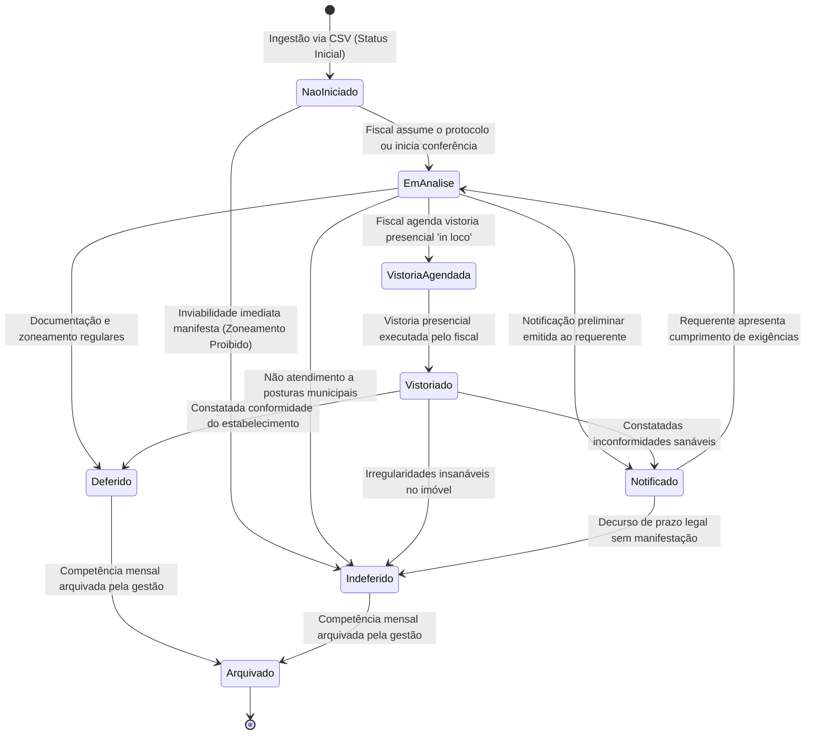
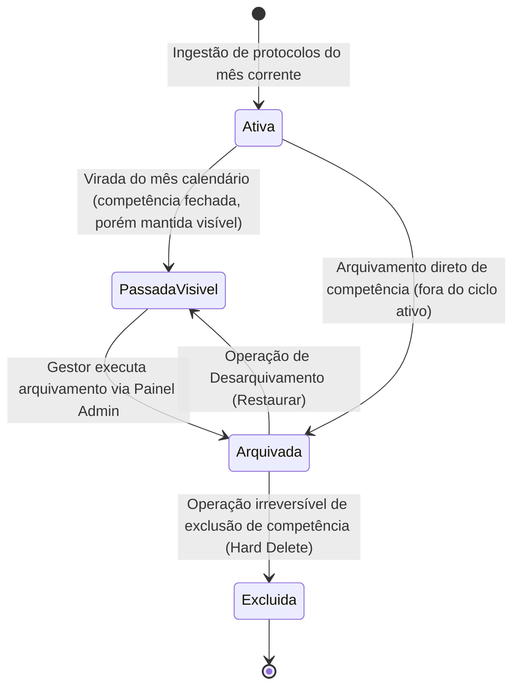

# 04 — Fluxos Operacionais e Modelagem de Dados

**Sistema**: Automação de Triagem VRE & Gestão Fiscal  
**Órgão**: Prefeitura Municipal de São José do Rio Preto — SP  
**Secretaria**: Secretaria Municipal de Habitação e Urbanismo (SMAURB) / Inspetoria Fiscal  
**Versão**: 2.2.0 (Patch v1.6)  
**Padrão de Engenharia**: Modelagem Comportamental e Estrutural / Diagramação Mermaid.js  

---

## 1. Visão Geral dos Fluxos do Sistema

O processamento do Sistema VRE é orquestrado através de pipelines desacoplados que integram ingestão de dados em lote, sanitização determinística, enriquecimento geográfico em camadas, persistência transacional ACID em SQLite (modo WAL) e renderização de planilhas formatadas via `openpyxl`.

Esta seção formaliza:
1. Os **Diagramas de Sequência** detalhando as interações temporais entre componentes.
2. O **Diagrama Estrutural de Classes e Módulos** do ecossistema Python.
3. O **Modelo Entidade-Relacionamento (DER)** das bases `triagem_vre.db` e `cep_areas.db`.
4. Os **Diagramas de Transição de Estados** que governam o ciclo de vida dos protocolos e das competências mensais.

---

## 2. Diagramas de Sequência

### 2.1. Fluxo 1: Ingestão Diária e Triagem Automatizada

O fluxo principal do `main_seco.py` opera a recepção e processamento de arquivos CSV depositados em `entrada_csv/`, aplicando normalização, classificação de risco, enriquecimento de área e persistência segura.

---

### 2.2. Fluxo 2: Sincronização Bidirecional e Preservação de Edições Humanas

Garante que quaisquer intervenções manuais realizadas pelos fiscais na planilha Excel (mudança de status, anotações de fiscalização, atribuição nominal de fiscal) sejam lidas de volta para o SQLite antes de qualquer nova geração, eliminando sobrescritas acidentais.

---

### 2.3. Fluxo 3: Arquivamento e Reconfiguração de Visibilidade

O módulo de arquivamento permite à chefia ou inspetor retirar meses/competências encerradas da visualização operacional ativa, mantendo o banco leve e gerando um snapshot histórico autônomo.

---

### 2.4. Fluxo 4: Importação em Lote de Planilhas Históricas e Reconciliação

Executado para carga retroativa de históricos legados, garantindo preservação de decisões passadas e populando a memória de atribuição fiscal por CNPJ.

---

## 3. Diagrama Estrutural de Classes e Módulos

O sistema é construído sobre módulos coesos e de baixo acoplamento organizados em três camadas lógicas:
- **`core`**: Domínio e infraestrutura fundamental (banco, normalização, enriquecimento e geração Excel).
- **`runner`**: Casos de uso de automação em lote e execução CLI (diária e histórica).
- **`admin`**: Casos de uso de gestão, governança, arquivamento e interface gráfica (GUI).

```mermaid
classDiagram
    %% Core Package
    class Config {
        <<module: core.config>>
        +DATABASE_PATH: Path
        +DATABASE_CEP_PATH: Path
        +ENTRADA_CSV_DIR: Path
        +PROCESSADOS_DIR: Path
        +PLANILHA_ATIVA_PATH: Path
        +COLUNAS_PLANILHA: List[str]
        +ESTILOS_CABECALHO: dict
        +REGRAS_CONDICIONAIS: list
        +obter_caminho_absoluto(relativo: str) Path
    }

    class Database {
        <<module: core.database>>
        +inicializar_banco() None
        +obter_conexao(caminho: Path) Connection
        +salvar_protocolos_triagem(protocolos: List[dict]) int
        +sincronizar_planilha_para_banco(caminho_excel: Path) int
        +obter_registros_ativos_ordenados() List[dict]
        +buscar_titular_anterior_cnpj(cnpj: str) Optional[str]
        +executar_transacao(query: str, params: tuple) Any
    }

    class Normalizer {
        <<module: core.normalizer>>
        -_RE_DIGITOS: Pattern
        -_RE_ESPACOS: Pattern
        -_MAPA_BAIRROS: dict
        +normalizar_cnpj(cnpj: str) str
        +normalizar_cep(cep: str) str
        +normalizar_bairro(bairro: str) str
        +normalizar_texto(texto: str) str
        +classificar_risco(cnae_primario: str, cnaes_sec: str) Tuple[str, str, str]
    }

    class CepService {
        <<module: core.cep_service>>
        +inicializar_banco_cep() None
        +resolver_area_fiscal(bairro: str, logradouro: str, cep: str) str
        +buscar_area_por_bairro(bairro: str) Optional[str]
        +buscar_area_por_cep(cep: str) Optional[str]
        +registrar_cep_pendente(cep: str, bairro: str, log: str) None
        +consultar_cache_web(cep: str) Optional[dict]
    }

    class ExcelWriter {
        <<module: core.excel_writer>>
        +gerar_planilha_controle(dados: List[dict], destino: Path) None
        +aplicar_formatacao_condicional(worksheet: Worksheet) None
        +ajustar_largura_colunas(worksheet: Worksheet) None
        +calcular_sha256_arquivo(caminho: Path) str
    }

    class HistoricoImporter {
        <<module: core.historico_importer>>
        +processar_planilha_historica(caminho: Path) dict
        +converter_data_excel(valor_celula: Any) str
        +canonizar_status(status_bruto: str) str
    }

    %% Runner Package
    class MainSeco {
        <<module: runner.main_seco>>
        +executar_pipeline_completo() bool
        +escanear_arquivos_csv(pasta: Path) List[Path]
        +processar_arquivo_csv(caminho_csv: Path) int
        +mover_para_processados(caminho_csv: Path) Path
    }

    class ImportarAntigas {
        <<module: runner.importar_antigas>>
        +executar_importacao_em_lote(pasta_origem: Path) None
    }

    %% Admin Package
    class ArchiveService {
        <<module: admin.archive_service>>
        +listar_competencias() List[dict]
        +arquivar_competencia(competencia: str, exportar: bool) int
        +desarquivar_competencia(competencia: str) int
        +excluir_competencia(competencia: str) int
        +exportar_competencia_excel(competencia: str, destino: Path) Path
    }

    class PainelAdminVRE {
        <<class: admin.main_admin.PainelAdminVRE>>
        -root: Tk
        -tree_competencias: Treeview
        -btn_arquivar: Button
        -btn_desarquivar: Button
        -btn_exportar: Button
        +__init__(master: Tk)
        +carregar_dados() None
        +on_arquivar_click() None
        +on_desarquivar_click() None
        +on_exportar_click() None
        +exibir_sobre() None
    }

    %% Relationships
    MainSeco --> Config : consome configurações
    MainSeco --> Database : persiste dados
    MainSeco --> Normalizer : limpa entradas
    MainSeco --> CepService : enriquece áreas
    MainSeco --> ExcelWriter : gera planilha ativa

    ImportarAntigas --> HistoricoImporter : orquestra
    HistoricoImporter --> Normalizer : sanitiza
    HistoricoImporter --> Database : grava histórico

    ArchiveService --> Database : manipula flags visibilidade
    ArchiveService --> ExcelWriter : exporta snapshots
    PainelAdminVRE --> ArchiveService : invoca regras de negócio
```

---

## 4. Modelo Entidade-Relacionamento e Esquema de Banco de Dados

O ecossistema utiliza dois bancos SQLite desacoplados:
1. **`triagem_vre.db`** (Banco Central de Negócio): Armazena os protocolos de viabilidade/licenciamento, metadados cadastrais, status processual e atribuição fiscal.
2. **`cep_areas.db`** (Banco Satélite de Inteligência Geográfica): Armazena as bases cartográficas, mapeamento de CEPs, logradouros, bairros e fila de pendências para aprendizado contínuo.

---

## 5. Diagramas de Transição de Estados

### 5.1. Máquina de Estados: Ciclo de Vida do Protocolo

Cada solicitação inserida na tabela `triagem` transita por uma máquina de estados finita que dita seu tratamento operacional e as regras de formatação condicional aplicadas no Excel.

### 5.2. Tabela de Transições e Regras de Negócio do Protocolo

| Estado de Origem | Evento / Gatilho | Estado de Destino | Ação do Sistema / Estilo Visual |
| :--- | :--- | :--- | :--- |
| **(Início)** | Ingestão de novo CSV | `Não Iniciado` | Linha com fundo padrão (sem destaque específico). |
| `Não Iniciado` | Atribuição manual de fiscal | `Em Análise` | Fundo Amarelo Suave (`#FFF2CC`) indicando processo em andamento. |
| `Em Análise` | Identificação de necessidade de inspeção | `Vistoria Agendada` | Fundo Azul Suave (`#D9E1F2`) alertando agendamento externo. |
| `Vistoria Agendada` | Realização da diligência em campo | `Vistoriado` | Fundo Roxo Suave (`#E2EFDA`) sinalizando vistoria concluída. |
| `Em Análise` / `Vistoriado` | Emissão de intimação ou pendência | `Notificado` | Fundo Laranja Suave (`#FCE4D6`) alertando prazo de contribuinte. |
| `Em Análise` / `Vistoriado` | Despacho favorável do auditor | `Deferido` | Fundo Verde Claro (`#E2EFDA`) e fonte verde escuro (`#375623`). |
| `Qualquer Estado Ativo` | Despacho denegatório de alvará | `Indeferido` | Fundo Vermelho Suave (`#F8CBAD`) e fonte vermelha escura (`#C65911`). |
| `Deferido` / `Indeferido` | Arquivamento via Painel Admin | `Arquivado` | `visivel = 0`, oculto da planilha ativa, migrado para snapshot. |

---

### 5.3. Máquina de Estados: Ciclo de Vida da Competência Mensal

As competências mensais (calculadas pelo campo `competencia`, ex: `2026-08`) possuem um ciclo de vida de visualização e persistência:

### 5.4. Regras de Transição da Competência

1. **Ativa (Corrente)**:
   - Todo novo protocolo do mês corrente entra automaticamente com `visivel = 1`.
   - Aparece na `Planilha_Controle_VRE_Ativa.xlsx`.
   - É editável por qualquer fiscal.

2. **Passada Visível**:
   - Competência de meses anteriores que ainda possui pendências ou vistorias ativas.
   - Mantida com `visivel = 1` para permitir consultas e conclusões.

3. **Arquivada (Oculta)**:
   - Acionada pelo `ArchiveService.arquivar_competencia()`.
   - Altera `visivel = 0` para todos os registros correspondentes.
   - Gera snapshot imutável em `Arquivados/VRE_Arquivado_AAAA-MM.xlsx`.
   - Reduz o tamanho e o tempo de abertura da planilha de trabalho ativa.

4. **Restaurada**:
   - Caso um protocolo antigo precise ser reavaliado na rotina diária, a competência pode ser reativada (`visivel = 1`), reincorporando as linhas na planilha de controle.
