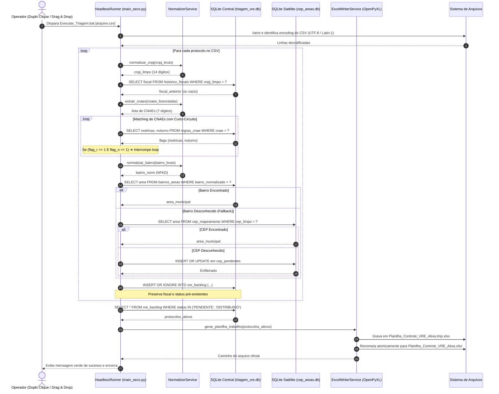
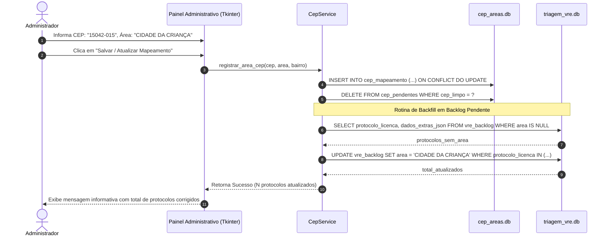
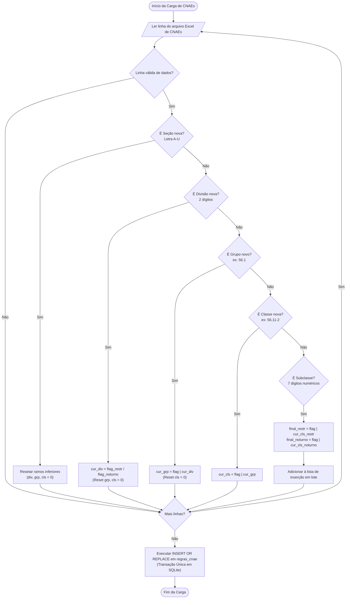
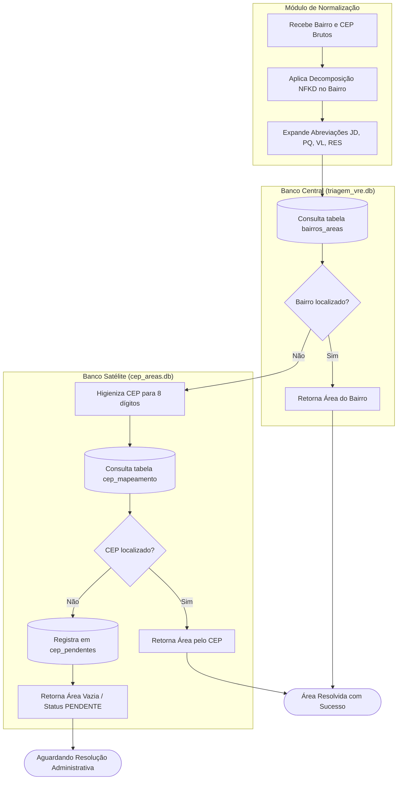

# Diagramas de Sequência e Atividades (UML 2.5)

**Sistema**: Automação de Triagem VRE — SMAURB / Inspetoria Fiscal  
**Padrão**: UML 2.5 Behavioral Models (OMG)  
**Versão**: 2.2.0  

---

## 1. Diagramas de Sequência

### 1.1. Sequência do Pipeline Headless (`triagem_vre`)
Ilustra a cadeia de execução instantânea disparada por duplo clique ou arraste de CSV:

---

### 1.2. Sequência de Mapeamento de CEP e Backfill Automático

---

## 2. Diagramas de Atividades

### 2.1. Algoritmo de Herança Hierárquica de CNAEs (Seeding)
Demonstra como restrições de Grupos e Classes propagam-se para as subclasses da tabela `regras_cnae`:

---

### 2.2. Algoritmo de Resolução de Área e Fallback com Raias (Swimlanes)

