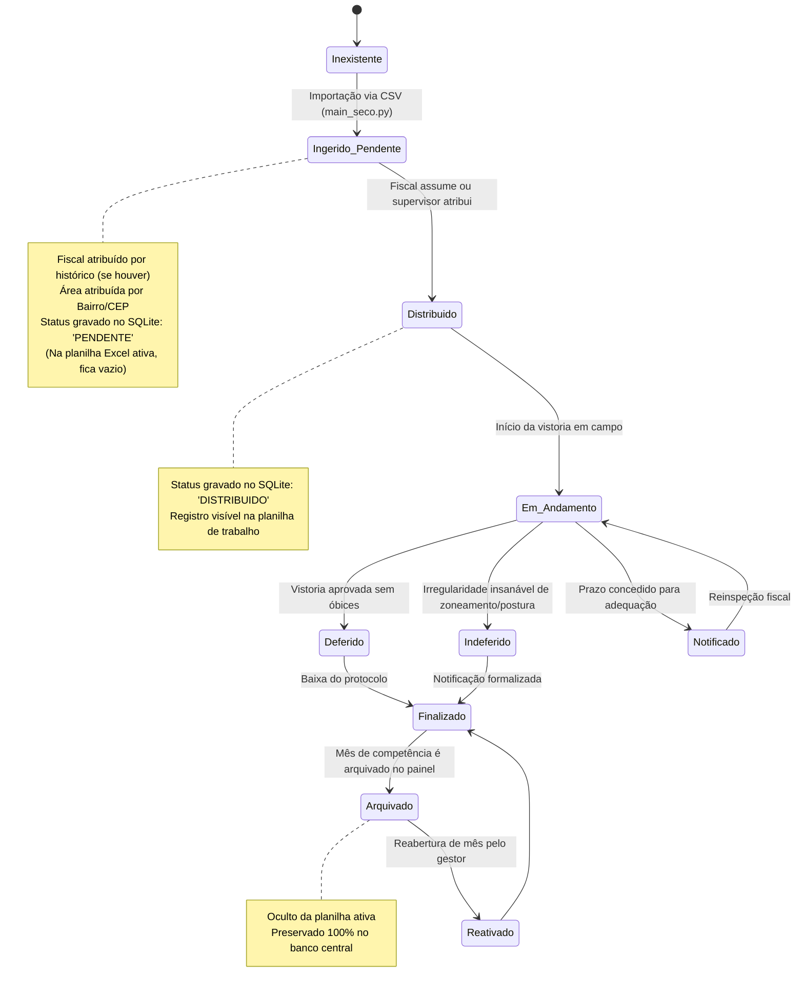
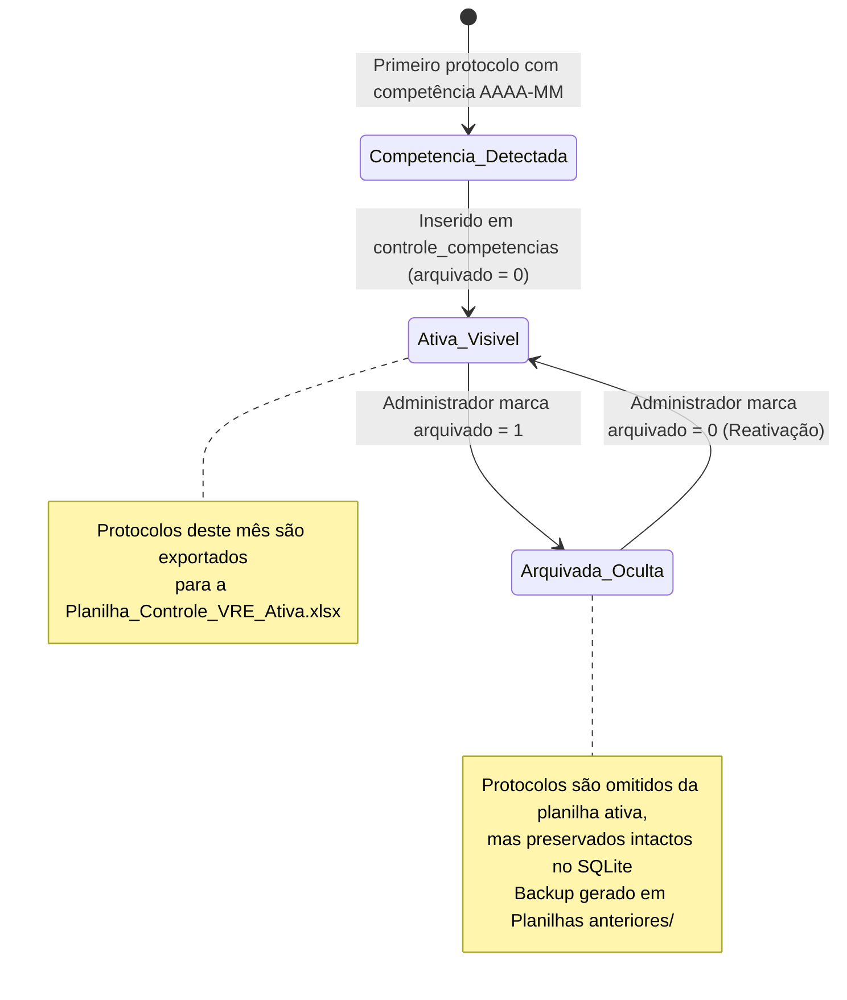
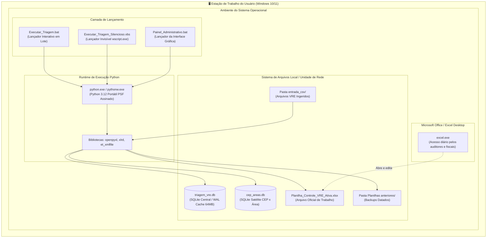

# Diagramas de Estados e Implantação (UML 2.5)

**Sistema**: Automação de Triagem VRE — SMAURB / Inspetoria Fiscal  
**Padrão**: UML 2.5 State Machine & Deployment Models (OMG)  
**Versão**: 2.2.0  

---

## 1. Diagramas de Máquina de Estados (Statechart)

### 1.1. Ciclo de Vida do Protocolo de Licenciamento (`vre_backlog`)
Demonstra as transições de estado de um protocolo empresarial desde sua emissão no VRE estadual até o arquivamento definitivo na Inspetoria Fiscal:

---

### 1.2. Ciclo de Vida da Competência Mensal (`controle_competencias`)

---

## 2. Diagrama de Implantação (Deployment Diagram)

Representa a topologia física e lógica de execução do sistema em ambiente corporativo municipal:

### 2.1. Características de Implantação
1. **Zero Privilégio Administrativo**: A instalação em modo portátil não requer permissões de Administrador do Windows nem modificação do Registro do sistema (`regedit`).
2. **Imunidade a Antivírus Corporativo (Symantec / Windows Defender)**:
   - Em vez de empacotar via executável monolítico (*dropper* temporário em `%TEMP%`), a solução portátil utiliza o binário oficial `python.exe` / `pythonw.exe`, que possui assinatura digital autêntica da *Python Software Foundation*.
3. **Resiliência a Quedas de Rede**: O uso do banco SQLite com `PRAGMA synchronous = NORMAL` e `journal_mode = WAL` assegura que oscilações transitórias na rede não corrompam os índices relacionais.
