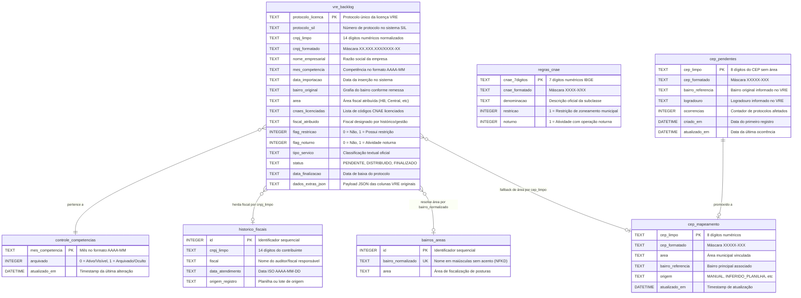

# Modelo de Dados Relacional (MER / DER)

**Sistema**: Automação de Triagem VRE — SMAURB / Inspetoria Fiscal  
**Padrão**: Modelo Entidade-Relacionamento Relacional (Peter Chen / Codd)  
**Banco de Dados**: SQLite 3 (Modo WAL)  
**Versão**: 2.2.0  

---

## 1. Diagrama Entidade-Relacionamento (DER)



---

## 2. Dicionário de Dados Detalhado

### 2.1. Tabela `vre_backlog` (Banco Central)
Armazena a totalidade dos protocolos de licenciamento importados.

| Coluna | Tipo | Nulo? | Padrão | Descrição e Regras |
| :--- | :--- | :--- | :--- | :--- |
| `protocolo_licenca` | `TEXT` | Não | PK | Código unívoco da licença expedida pelo VRE (ex.: `B000100...`). |
| `protocolo_sil` | `TEXT` | Sim | `NULL` | Protocolo gerado no integrador estadual SIL. |
| `cnpj_limpo` | `TEXT` | Não | - | Chave de busca fiscal contendo exatamente 14 dígitos numéricos. |
| `cnpj_formatado` | `TEXT` | Sim | `NULL` | CNPJ formatado para exibição visual na planilha de trabalho. |
| `nome_empresarial` | `TEXT` | Sim | `NULL` | Razão social ou denominação da pessoa jurídica. |
| `mes_competencia` | `TEXT` | Não | - | Mês extraído da data oficial do VRE no formato `AAAA-MM`. |
| `data_importacao` | `TEXT` | Não | - | Data em que a linha foi ingerida pelo pipeline. |
| `bairro_original` | `TEXT` | Sim | `NULL` | Bairro textual exato como expedido no CSV do VRE. |
| `area` | `TEXT` | Sim | `NULL` | Região fiscal municipal (ex.: `HB`, `CENTRAL`, `BOSQUE`). |
| `cnaes_licenciadas`| `TEXT` | Sim | `NULL` | String contendo todos os CNAEs autorizados na licença. |
| `fiscal_atribuido` | `TEXT` | Sim | `NULL` | Fiscal que atendeu historicamente ou designado pela supervisão. |
| `flag_restricao` | `INTEGER` | Não | `0` | `1` se qualquer atividade possuir restrição de uso e ocupação do solo. |
| `flag_noturno` | `INTEGER` | Não | `0` | `1` se qualquer atividade operar no período noturno. |
| `tipo_servico` | `TEXT` | Sim | - | Classificação de atendimento (`Sem Restrição Livre`, etc.). |
| `status` | `TEXT` | Não | `'PENDENTE'`| Estado de atendimento (`PENDENTE`, `DISTRIBUIDO`, `FINALIZADO`). |
| `data_finalizacao` | `TEXT` | Sim | `NULL` | Data de conclusão da vistoria e arquivamento administrativo. |
| `dados_extras_json`| `TEXT` | Sim | `NULL` | Objeto JSON preservando integralmente todas as colunas do CSV VRE. |

---

### 2.2. Tabela `historico_fiscais` (Banco Central)
Indexa todos os atendimentos fiscais passados para garantia de continuidade na fiscalização.

| Coluna | Tipo | Nulo? | Padrão | Descrição e Regras |
| :--- | :--- | :--- | :--- | :--- |
| `id` | `INTEGER` | Não | PK Auto | Identificador primário sequencial. |
| `cnpj_limpo` | `TEXT` | Não | - | 14 dígitos numéricos indexados via B-Tree. |
| `fiscal` | `TEXT` | Não | - | Nome completo ou denominação oficial do fiscal. |
| `data_atendimento`| `TEXT` | Sim | `NULL` | Data ISO (`AAAA-MM-DD`) da realização do atendimento. |
| `origem_registro` | `TEXT` | Sim | `NULL` | Origem da carga (ex.: `Planilha_Legada_2025`, `Manual`). |

---

## 3. Otimizações de Desempenho e Pragmas do SQLite

Para viabilizar consultas em subsegundo mesmo com centenas de milhares de linhas, os seguintes pragmas de engenharia são configurados:

```sql
PRAGMA journal_mode = WAL;
PRAGMA synchronous = NORMAL;
PRAGMA cache_size = -64000;      -- Alocação de 64 MB de cache RAM para páginas B-Tree
PRAGMA temp_store = MEMORY;      -- Tabelas e ordenações temporárias mantidas em memória
```

### 3.1. Índices Estratégicos Criados
- `idx_backlog_cnpj` em `vre_backlog(cnpj_limpo)`: Busca imediata de duplicatas.
- `idx_backlog_status` em `vre_backlog(status)`: Acelera filtragem de protocolos em aberto.
- `idx_backlog_competencia` em `vre_backlog(mes_competencia)`: Filtragem instantânea na geração de planilhas.
- `idx_hist_cnpj` em `historico_fiscais(cnpj_limpo)`: Consulta de histórico em $O(\log N)$.
- `uq_hist_cnpj_fiscal` (UNIQUE): Impede duplicação do mesmo par (CNPJ x Fiscal).
- `idx_bairro_norm` em `bairros_areas(bairro_normalizado)`: Resolução direta por hash B-Tree.
